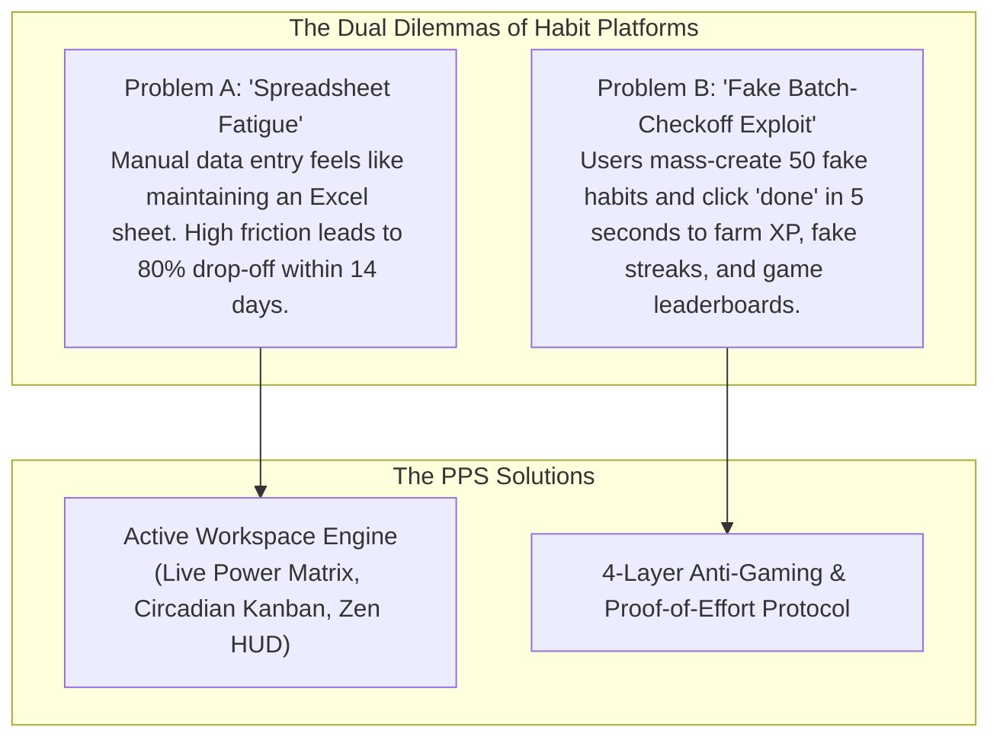
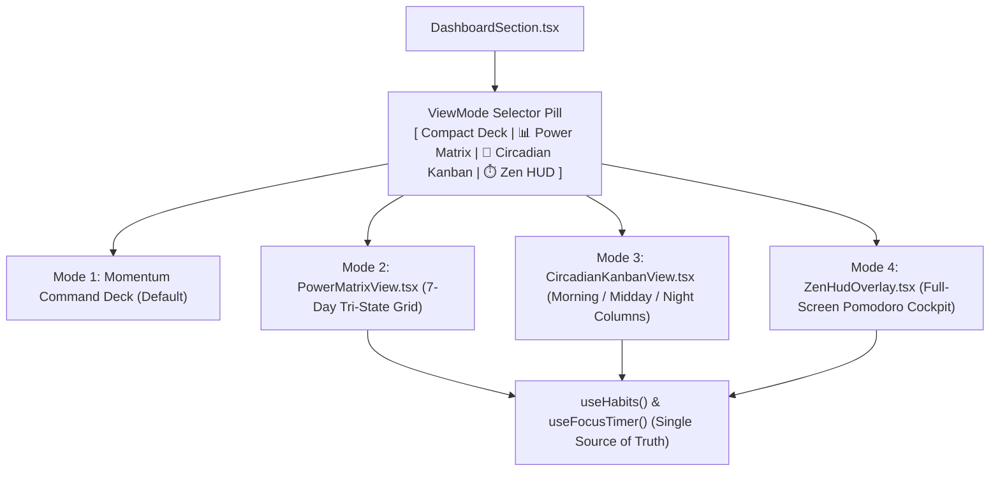
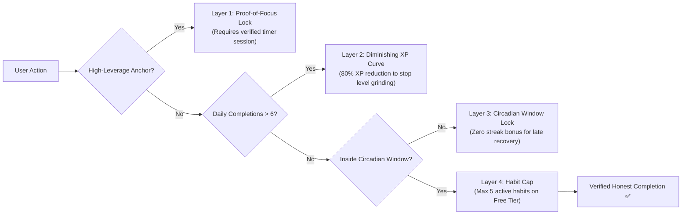

# 🧠 PPS Innovation, Active Workspace & Anti-Gaming Blueprint
### *Preserving Next-Gen Habit Representations, UX Innovation & Integrity Protocols*

> **Status:** ARCHITECTURAL KNOWLEDGE REPOSITORY & GIT CODE REFERENCE 🏛️  
> **Repository Path:** `docs/PPS_INNOVATION_AND_ANTI_GAMING_BLUEPRINT.md`  
> **Purpose:** Permanent repository document preserving our strategic roadmap on eliminating spreadsheet fatigue, introducing next-gen visual representations, and enforcing strict anti-gaming mechanics across upcoming releases.  
> **Prototype Companion:** `interactive_workspace_prototype.html` · [Live Screenshot](file:///c:/Users/rjaya/OneDrive/Desktop/PPS/Personal-Performance-System/docs/screenshots/interactive_workspace_screenshot.png)

---

## 📸 Interactive Workspace Prototype Visual Snapshot

---

## 🎯 1. The Core UX Problems We Are Solving

---

## 📊 2. Beyond Spreadsheets: 5 Innovative Workspace Views

Instead of treating habit tracking as a passive database or static checklist, PPS transforms it into an **active execution cockpit**:

### 1. The Live Power Matrix *(Notion Table Reimagined)*
* **Layout:** High-density 7-day grid showing all active habits in rows and days of the week in columns.
* **Tri-State Interactive Cells:**
  * **Single-Tap:** Full Completion (`✓`, +10 XP awarded).
  * **Double-Tap:** 2-Minute Micro-Action (`2m` shield icon, protects streak on busy days per Agni 2.0).
  * **Long-Press / ⚡ Button:** Instantly launches an integrated 25-minute Pomodoro sprint for that exact habit.

### 2. Circadian Kanban Flow *(Biological Board View)*
* **Layout:** Columns mapped to circadian cognitive energy rather than arbitrary dates:
  * **🌅 Morning Ignition (6am–12pm):** High-focus analytical habits (DSA, Writing, Deep Reading).
  * **☀️ Afternoon Stamina (12pm–6pm):** Execution and collaborative tasks (Code Review, Exercise).
  * **🌙 Evening Curfew & Wind-Down (6pm–10pm):** Screen detox, reflection, and sleep hygiene before the 10 PM Agni Curfew.
* **Auto-Shift:** Habits automatically group into their optimal biological window.

### 3. Live Day-Stream Timeline *(Interactive Gantt Arc)*
* **Layout:** Horizontal time-block arc with an animated pulsating **"Now"** needle.
* **Intelligent Alerts:** Highlights unscheduled time blocks and visualizes deadline compression before curfew.

### 4. GitHub-Style Vitality Heatmap *(Proof-of-Discipline Matrix)*
* **Layout:** 52-week punch-card grid displaying daily completion density from emerald to fiery orange.
* **Gamification:** Visual proof-of-work that rewards unbroken lifestyle consistency.

### 5. Zen Cockpit HUD *(Single-Action Focus Mode)*
* **Layout:** Full-screen minimal interface that hides all sidebars, tables, and lists.
* **Execution:** Displays only the **single highest-leverage habit** due right now with an animated radial countdown and synthetic binaural alpha soundscapes.

---

## 🛠️ 3. Dashboard Integration Architecture (Roadmap Plan)

When integrating these views into the main Dashboard in upcoming releases, the architecture preserves zero regression on existing hooks:

### Component Implementation Breakdown:
1. **Target Component:** `src/components/dashboard/v2/InteractiveQuickDock.tsx` and `src/components/sections/DashboardSection.tsx`.
2. **State Management:** Add `const [dashboardLayout, setDashboardLayout] = useState<'deck' | 'matrix' | 'kanban'>('deck')` backed by `localStorage.getItem('pps_dash_layout')`.
3. **Data Binding:**
   - Cells in `PowerMatrixView` bind directly to `toggleCompletion(habitId)` and `completeHabit(habitId, 'micro')`.
   - The inline `⚡ Focus` button dispatches directly to `focusTimer.startHabitFocus(habitId, habitName, 25)`.
4. **Mobile Responsiveness (390px):**
   - On screens < 640px, the 7-day matrix horizontally scrolls smoothly with sticky habit-name columns, or auto-collapses to a 3-day window `[ Yesterday | Today | Tomorrow ]`.

---

## 🛡️ 4. The 4-Layer Anti-Gaming & Integrity Protocol

To prevent users from mass-creating fake habits and clicking 50 checkmarks in 5 seconds, PPS enforces four cryptographic and behavioral layers:

### Layer Details:
1. **Proof-of-Focus Lock (`requires_focus_timer`):**
   * Critical habits (e.g., "2-Hour Coding Sprint", "Semester Exam Prep") cannot be checked off with a raw checkbox.
   * The user must launch the timer in the Focus Studio and complete at least 80% of the session before the habit self-verifies.
2. **Diminishing XP Velocity Curve:**
   * Habits 1 through 3 award full **100% XP (+20 XP)**.
   * Habits 4 through 6 award **50% XP (+10 XP)**.
   * Beyond 6 completions in a single day, XP awards drop to **0 XP** (status marks complete, but no XP can be farmed).
3. **Circadian Time-Window Locks:**
   * Morning habits carry `window_start` (06:00) and `window_end` (12:00).
   * Checking off a morning habit at 11:30 PM logs as a "Late Override" and awards zero bonus XP or streak multipliers.
   * The **10 PM Agni Curfew** locks daily progression to protect natural circadian recovery.
4. **Habit Overload Throttling (The Rule of 5):**
   * Free-tier users are capped at **5 active daily anchor habits**.
   * Behavioural science shows that tracking >7 habits causes an 85% burnout rate within 3 weeks. Users must master their top 5 before unlocking additional slots.

---

## 🥊 5. Competitor Benchmark Matrix

| Retention / Mechanism | Duolingo | Habitica | Forest | **PPS (Our Advantage)** |
| :--- | :---: | :---: | :---: | :---: |
| **Anti-Gaming Guards** | Daily XP caps | Health mana costs | Timer interruption penalty | **Proof-of-Focus + Diminishing XP + Curfew Locks** |
| **Streak Protection** | Paid streak freeze | Inn rest mode | None | **Streak Shields + 2-Day Rolling Rest Allowance** |
| **Workspace View** | Rigid linear path | 3-column list | Tree forest grid | **Live Power Matrix + Circadian Kanban + Zen HUD** |
| **Zero-Friction Entry** | Lesson quiz only | Manual clicks | Manual timer only | **Timer Auto-Complete + Voice NLP + Lock-Screen 1-Tap** |
| **Burnout Prevention** | None (guilt notifications) | HP damage | Dead tree guilt | **Agni 2.0 Micro-Habit 2m Fallback + Sleep Curfew** |

---

## 📁 6. Repository Documentation & Artifact Index

| Document / Asset | Location | Core Value |
| :--- | :--- | :--- |
| **Innovation & Anti-Gaming** | [`docs/PPS_INNOVATION_AND_ANTI_GAMING_BLUEPRINT.md`](file:///c:/Users/rjaya/OneDrive/Desktop/PPS/Personal-Performance-System/docs/PPS_INNOVATION_AND_ANTI_GAMING_BLUEPRINT.md) | UX Innovations, Dashboard Integration Plan & 4-Layer Anti-Gaming Protocol |
| **Visual Prototype Screenshot** | [`docs/screenshots/interactive_workspace_screenshot.png`](file:///c:/Users/rjaya/OneDrive/Desktop/PPS/Personal-Performance-System/docs/screenshots/interactive_workspace_screenshot.png) | High-res UI snapshot of the 3 active workspace views |
| **48-Hour Master Plan** | [`docs/PPS_48H_ACCELERATED_DEPLOYMENT_PLAN.md`](file:///c:/Users/rjaya/OneDrive/Desktop/PPS/Personal-Performance-System/docs/PPS_48H_ACCELERATED_DEPLOYMENT_PLAN.md) | V1 Demo Drop (Today), Monetization (Tomorrow AM), Squads (Tomorrow PM) |
| **V1 Tool Handoff Contract** | [`docs/PPS_V1_EXECUTION_AND_TOOL_HANDOFF.md`](file:///c:/Users/rjaya/OneDrive/Desktop/PPS/Personal-Performance-System/docs/PPS_V1_EXECUTION_AND_TOOL_HANDOFF.md) | Tool Boundaries: Antigravity (Backend/Native) vs Kilo (UI/Test) |
| **Interactive HTML Prototype** | [`interactive_workspace_prototype.html`](file:///C:/Users/rjaya/.gemini/antigravity/brain/79fd0834-7491-49c3-89ac-9efe2d791831/interactive_workspace_prototype.html) | Live interactive HTML demonstration of Power Matrix, Kanban, and HUD |
