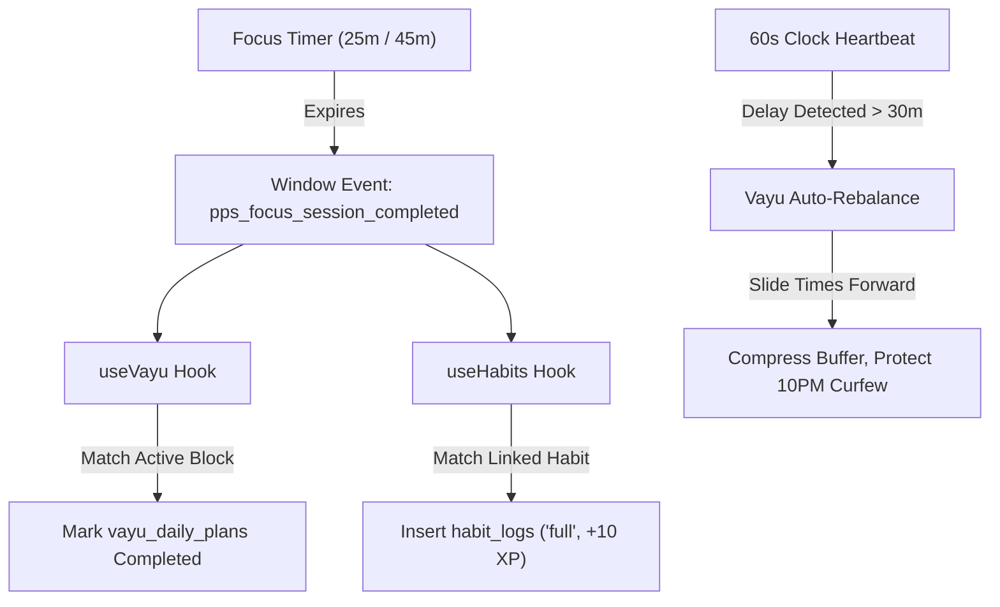

# 📘 PPS (Personal Performance System) — Master Engineering & Product Specification (v2.0)

> **Document Version:** 2.0.0  
> **Target Release:** Agni 2.0 & Vayu 1.0 Unified Milestone (October 2026 – March 2027)  
> **Authors:** Jayadeep (Lead Architect / Product Owner) & AI Lead Architecture Council  
> **Classification:** Living Operational Document & Autonomous Agent Execution Guide  
> **Location:** `docs/PPS_MASTER_SPECIFICATION.md`

---

## 📑 Table of Contents

1. [Executive Summary & Core Philosophy](#1-executive-summary--core-philosophy)
2. [User Psychology & Cognitive Architecture](#2-user-psychology--core-cognitive-architecture)
   - [2.1 The 3-Second Rule & Cognitive Unburdening](#21-the-3-second-rule--cognitive-unburdening)
   - [2.2 AI Coach Persona Modes](#22-ai-coach-persona-modes-customizable-interaction-layer)
   - [2.3 Parkinson's Law Inverter & Anti-Procrastination Time Slicing](#23-parkinsons-law-inverter--anti-procrastination-time-slicing)
   - [2.4 Emergency Triage ("Panic Button") Loop](#24-emergency-triage-panic-button-loop)
   - [2.5 Syllabus-to-Habit Decomposition Engine](#25-syllabus-to-habit-decomposition-engine)
3. [Autonomous Agent Execution Rules (AG & Jules Mandate)](#3-autonomous-agent-execution-rules-ag--jules-mandate)
   - [3.1 Zero Placeholder & Real Data Policy](#31-zero-placeholder--real-data-policy)
   - [3.2 Screenshot Lifecycle & Clean Git Protocol](#32-screenshot-lifecycle--clean-git-protocol)
   - [3.3 Phased Verification Loop & Test Integrity](#33-phased-verification-loop--test-integrity)
   - [3.4 Stop & Report Triggers](#34-stop--report-triggers)
4. [Domain Models, Database Contracts & State Machines](#4-domain-models-database-contracts--state-machines)
   - [4.1 PostgreSQL Schema Extensions & RLS](#41-postgresql-schema-extensions--rls)
   - [4.2 The Agni 2.0 Three-Tier Habit State Machine](#42-the-agni-20-three-tier-habit-state-machine)
   - [4.3 Vayu 1.0 Autonomous Event Pipeline](#43-vayu-10-autonomous-event-pipeline)
5. [Phased Implementation Task Catalog](#5-phased-implementation-task-catalog)
   - [Phase 1: Agni 2.0 Hardening (Proof-of-Focus & Streak Integrity)](#phase-1-agni-20-hardening-proof-of-focus--streak-integrity)
   - [Phase 2: Vayu 1.0 Fluid Flow (Schedule Rebalancer & Realtime Bus)](#phase-2-vayu-10-fluid-flow-schedule-rebalancer--realtime-bus)
   - [Phase 3: The Dopamine & Motivation Engine (Personas & Time Slicer)](#phase-3-the-dopamine--motivation-engine-personas--time-slicer)
   - [Phase 4: Dashboard V2 Deep Polish & Analytics Studio](#phase-4-dashboard-v2-deep-polish--analytics-studio)
   - [Phase 5: Native Mobile Hardening & Viral Social Bridge](#phase-5-native-mobile-hardening--viral-social-bridge)

---

## 1. Executive Summary & Core Philosophy

The Personal Performance System (PPS) is an ambient, circadian-synchronized performance operating system designed for students, competitive exam aspirants, and software engineers.

### The Foundational Diagnosis
Standard habit trackers fail because **the administrative overhead of the app becomes homework**. When a user already feels overwhelmed by assignments, exams, or fatigue, opening a complex digital cockpit that demands manual input and maintenance triggers guilt and abandonment.

### The Core Promise
1. **Zero Cognitive Friction:** The app decides *what* needs to be done *right now*, eliminating decision paralysis.
2. **Biological Alignment (Vayu):** Difficult tasks match peak morning cortisol and focus windows; low-cognitive tasks match afternoon dips.
3. **No-Shame Resilience (Agni 2.0):** Falling behind rebalances the day automatically. No red "FAILED" marks, no broken streak spirals.
4. **Mechanical Proof-of-Focus:** Check-offs for high-impact tasks require real, timed focus sprints, preserving personal integrity and leaderboard trust.

---

## 2. User Psychology & Core Cognitive Architecture

### 2.1 The 3-Second Rule & Cognitive Unburdening
When a user launches PPS, they must experience clarity within **3 seconds**:
- **Second 0–3:** The screen displays a single focal point: the **Next Best Action Card** (e.g., *"Operating Systems: 25m Focus Sprint"*). Secondary widgets sit quietly below.
- **Second 3–10:** One tap on `⚡ Sprint (25m)` or hitting <kbd>Space</kbd> starts the focus timer, turns on ambient acoustic white noise, and locks out distraction.
- **On Day Derailment:** Instead of 5 missed alarms, PPS presents a calm rebalance banner: *"You are running 45m behind schedule. Evening blocks have been re-flowed and your 10:00 PM sleep curfew is protected. Tap to confirm."*

---

### 2.2 AI Coach Persona Modes (Customizable Interaction Layer)
Users can select their preferred coaching voice in Settings (`profiles.ai_coach_persona`):

| Persona Mode | Tone & Attitude | Psychological Strategy | Ideal User State |
| :--- | :--- | :--- | :--- |
| **🔥 Agni Fire** | Direct, uncompromising, high-energy, military discipline. | Strips excuses. Emphasizes competition, deadlines, and the cost of complacency. | Procrastinating, low energy, needing an external push. |
| **🌬️ Vayu Flow** | Calm, strategic, Stoic, objective, analytical. | Rebalances reality without emotion. Focuses on pacing, circadian optimization, and energy economics. | Balanced daily study, system building, deep work. |
| **🌿 Prana Calm** | Warm, encouraging, highly empathetic, supportive. | Validates stress, suggests micro-habit ladders (2-min starts), and protects mental health. | Burnout risk, high anxiety, recovery/sick days. |

---

### 2.3 Parkinson's Law Inverter & Anti-Procrastination Time Slicing
*Parkinson's Law dictates that work expands to fill the time available for its completion.* When an assignment is due in 7 days, the brain treats it as low urgency until Day 6, causing high stress and poor work quality.

#### The PPS Anti-Procrastination Protocol
When a future deadline is added:
1. **Interactive Time-Horizon Slicing:** PPS prompts:  
   > *"Operating Systems Assignment due in 7 days. If you started right now, how many minutes would it take to outline Page 1?"*  
   > `[ 10 mins ]` | `[ 15 mins ]` | `[ 20 mins ]`
2. **The "Micro-Bite" Dopamine Hook:**  
   If the user selects 15 minutes, PPS generates a 15-minute micro-sprint today:  
   > *"Knock out Page 1 in 15 minutes right now, and you can take the entire evening off guilt-free."*
3. **Artificial Early Horizon:** PPS internally schedules milestone checkpoints 48 hours before the actual hard deadline, protecting against last-minute emergencies.

---

### 2.4 Emergency Triage ("Panic Button") Loop
For days when multiple deadlines collide and the user feels paralyzed:
1. User taps the **🚨 Triage Mode** button on the dashboard header.
2. PPS asks: *"What is the single non-negotiable outcome that MUST happen today?"*
3. The user picks one task.
4. **Instant Quarantine:** All other scheduled habits are muted for the day; streak shields are armed automatically (+0 XP, but streak preserved).
5. The dashboard strips away all secondary widgets and presents a dedicated three-sprint timeline exclusively for that single objective.

---

### 2.5 Syllabus-to-Habit Decomposition Engine
Students often fail to prepare for exams because syllabi are massive, monolithic documents.
1. **Input:** User pastes course text or uploads exam topics (GATE, University, Coding Interview roadmap).
2. **Algorithmic Decomposition:** PPS divides the topics into a 30-day spaced-repetition sequence.
3. **Daily Habit Injection:** Each morning, exactly one concrete micro-topic (e.g., *"B-Trees & Indexing (DBMS) — 30m Drill"*) automatically surfaces as an anchor habit in the user's checklist.

---

## 3. Autonomous Agent Execution Rules (AG & Jules Mandate)

All automated coding agents operating on this repository must strictly adhere to these non-negotiable operational directives:

### 3.1 Zero Placeholder & Real Data Policy
- **No Mock Text:** Never insert placeholder strings like `"Project Nova"`, `"Phoenix Sprint"`, fake user names, or artificial statistics into production components.
- **Live Hook Sourcing:** Every visible string and metric must originate from real reactive hooks: `useHabits`, `useFocusTimer`, `useProfile`, `useGroups`, or `useReminders`.
- **Honest Empty States:** If a user has no habits or no squad peers online, render an intentional, helpful empty state (e.g., *"No active focus sessions in squad — be the first to start"*).

---

### 3.2 Screenshot Lifecycle & Clean Git Protocol
- **Automated Verification:** For every UI stage, AG must run Playwright scripts capturing real browser renders (Desktop 1440px and Mobile 390px, in both Light and Dark themes) saved under `screenshots/stage-N/`.
- **Visual Defect Inspection:** Inspect every screenshot for overlapping divs, text clipping, contrast failures, and broken safe-area insets.
- **MANDATORY PURGE BEFORE GIT OPERATIONS:**
  ```bash
  # Pre-commit cleanup requirement:
  rm -rf screenshots/
  git status
  ```
  **Screenshots must NEVER be staged, committed, or pushed to GitHub.** The repository git tree must remain strictly clean of binary screenshot artifacts.

---

### 3.3 Phased Verification Loop & Test Integrity
Before marking any stage complete:
1. Run TypeScript check: `npx tsc --noEmit` (must report 0 errors).
2. Run Vitest suite: `npm test` (the baseline count of 182 tests must NEVER decrease).
3. Run Playwright E2E specs: `npx playwright test`.
4. Run production build: `npm run build` (must bundle in under 15s).
5. Update `AGNI_RUN_LOG.md` documenting:
   - Specific files modified or created.
   - Exact test counts before and after.
   - Visual checks performed.
   - Any items that could not be verified in local headless mode.

---

### 3.4 Stop & Report Triggers
An agent must immediately halt execution and request guidance if:
1. Any Vitest test fails and remains unfixed after **two consecutive attempts**.
2. A task requires introducing a new npm dependency not already listed in `package.json`.
3. A task requires a destructive database change (`DROP TABLE`, `DROP COLUMN`). In this case, write the proposed DDL to `supabase/PENDING_MIGRATION.sql` and stop.

---

## 4. Domain Models, Database Contracts & State Machines

### 4.1 PostgreSQL Schema Extensions & RLS

```sql
-- Migration: 20261015000000_master_pps_v2.sql

-- 1. Extend user profiles with AI persona & triage state
ALTER TABLE public.profiles
ADD COLUMN IF NOT EXISTS ai_coach_persona TEXT DEFAULT 'vayu_flow' 
    CHECK (ai_coach_persona IN ('agni_fire', 'vayu_flow', 'prana_calm')),
ADD COLUMN IF NOT EXISTS is_triage_active BOOLEAN NOT NULL DEFAULT FALSE,
ADD COLUMN IF NOT EXISTS triage_target_habit_id UUID REFERENCES public.habits(id) ON DELETE SET NULL,
ADD COLUMN IF NOT EXISTS weekly_rest_days_used INTEGER NOT NULL DEFAULT 0,
ADD COLUMN IF NOT EXISTS last_rest_day_date DATE;

-- 2. Extend habit definitions with mechanical locks & windows
ALTER TABLE public.habits
ADD COLUMN IF NOT EXISTS requires_focus_timer BOOLEAN NOT NULL DEFAULT FALSE,
ADD COLUMN IF NOT EXISTS focus_duration_minutes INTEGER DEFAULT 25,
ADD COLUMN IF NOT EXISTS window_start TIME,
ADD COLUMN IF NOT EXISTS window_end TIME;

-- 3. Detailed Habit Logs (Full, Micro, Rest Day tracking)
CREATE TABLE IF NOT EXISTS public.habit_logs (
    id UUID PRIMARY KEY DEFAULT gen_random_uuid(),
    habit_id UUID NOT NULL REFERENCES public.habits(id) ON DELETE CASCADE,
    user_id UUID NOT NULL REFERENCES auth.users(id) ON DELETE CASCADE,
    completed_date DATE NOT NULL,
    completion_type TEXT NOT NULL CHECK (completion_type IN ('full', 'micro', 'rest')),
    focus_minutes_logged INTEGER DEFAULT 0,
    xp_awarded INTEGER NOT NULL DEFAULT 10,
    rest_reason TEXT,
    created_at TIMESTAMPTZ NOT NULL DEFAULT NOW(),
    UNIQUE(habit_id, completed_date)
);

ALTER TABLE public.habit_logs ENABLE ROW LEVEL SECURITY;

CREATE POLICY "Users view own habit logs"
ON public.habit_logs FOR SELECT TO authenticated
USING (auth.uid() = user_id);

CREATE POLICY "Users insert own habit logs"
ON public.habit_logs FOR INSERT TO authenticated
WITH CHECK (auth.uid() = user_id);
```

---

### 4.2 The Agni 2.0 Three-Tier Habit State Machine

Every habit interaction in `src/hooks/use-habits.tsx` must adhere to these mathematical caps:

```
┌────────────────────────────────────────────────────────────────────────┐
│                        HABIT COMPLETION TIERS                          │
├───────────────────┬────────┬──────────────┬──────────────┬─────────────┤
│ Completion Type   │ XP     │ Weekly Cap   │ Streak Effect│ Audit Class │
├───────────────────┼────────┼──────────────┼──────────────┼─────────────┤
│ 1. Full Complete  │ +10 XP │ Unlimited    │ Advances (+1)│ Verified    │
│ 2. 2m Micro-Habit │ +2 XP  │ Max 3/wk/task│ Preserves (=)│ Grace       │
│ 3. Logged Rest Day│ +5 XP  │ Max 2/wk     │ Shields (=)  │ Recovery    │
└───────────────────┴────────┴──────────────┴──────────────┴─────────────┘
```

#### Deterministic Rules:
1. **Mechanical Proof Lock:** If `habit.requires_focus_timer === true`, direct checkmark clicks are intercepted. The habit transitions to `full` exclusively via `pps_focus_session_completed`.
2. **Micro-Habit Scaling:** When a user is exhausted, clicking `🪜 2m Micro` allows checking off a 2-minute version. It awards 2 XP and protects the streak, but does not qualify for "Perfect Day" celebrations. Max 3 times per habit per week.
3. **Rest Day Enforcement:** Max 2 rest days in any rolling 7-day window. Prevents endless streak freezing without real work.

---

### 4.3 Vayu 1.0 Autonomous Event Pipeline



---

## 5. Phased Implementation Task Catalog

### Phase 1: Agni 2.0 Hardening (Proof-of-Focus & Streak Integrity)

- [ ] **Task 1.1:** Implement `canLogRestDay()` and `canLogMicroHabit()` pure verification functions with strict unit tests in `use-habits-agni2.test.ts`.
- [ ] **Task 1.2:** Implement `isWithinCircadianWindow(habit, currentTime)` enforcing morning/evening locks.
- [ ] **Task 1.3:** Bind `pps_focus_session_completed` custom window event listener in `use-habits.tsx` to handle auto-completion of timer-locked tasks.
- [ ] **Task 1.4:** Implement procedural Web Audio harmonic chimes in `src/lib/audio.ts` (C-Major for deep work, pentatonic sparkle for health, muted click for micro).

---

### Phase 2: Vayu 1.0 Fluid Flow (Schedule Rebalancer & Realtime Bus)

- [ ] **Task 2.1:** Upgrade `vayuPlanner.ts` with the 45/15 dynamic rhythm builder matching circadian energy blocks.
- [ ] **Task 2.2:** Build the Zero-Guilt Schedule Rebalancer: shifts uncompleted blocks forward on delay without marking tasks failed.
- [ ] **Task 2.3:** Implement ambient natural language intent classifier in `src/lib/vayu/vayuPlanner.ts` (0ms client-side matching with Gemini fallback).
- [ ] **Task 2.4:** Build the Vayu Pulse Banner HUD on the dashboard with direct timeblock sprint launcher.

---

### Phase 3: The Dopamine & Motivation Engine (Personas & Time Slicer)

- [ ] **Task 3.1:** Create `src/lib/ai/coachPersonas.ts` defining prompt profiles and response templates for **Agni Fire**, **Vayu Flow**, and **Prana Calm**.
- [ ] **Task 3.2:** Build the **Parkinson's Law Inverter Modal**: when creating a habit with a distant deadline, prompt for a 10–15 min immediate micro-start.
- [ ] **Task 3.3:** Build the **🚨 Emergency Triage ("Panic Button") Component**: isolates one single critical task, shields streaks, and mutes background noise.
- [ ] **Task 3.4:** Build the **Syllabus-to-Habit Decomposer**: text/PDF topic parser that seeds a 30-day sequential study track.

---

### Phase 4: Dashboard V2 Deep Polish & Analytics Studio

- [x] **Task 4.1:** Consolidate the Hero Header into the unified **Momentum Command Deck** (Vitality Score, Active Track HUD, Agni Curfew indicator).
- [x] **Task 4.2:** Integrate Track-Adaptive 1-Tap Habit Chips (`QuickAddHabitCard.tsx`) tailored to Placements, Exams, Coding, and Fitness.
- [x] **Task 4.3:** Build the dedicated Analytics Studio (`/analytics`): weekly focus curves, 30-day completion heatmap, and personal best records.
- [x] **Task 4.4:** Enforce data honesty on charts: circadian energy correlation requires $\ge 14$ days of real data; otherwise show clean empty states.

---

### Phase 5: Native Mobile Hardening & Viral Social Bridge

- [x] **Task 5.1:** Sync Capacitor assets and compile `app-debug.apk` with hardware back-button interceptor and safe-area insets.
- [x] **Task 5.2:** Build the WhatsApp Study Buddy invite generator (`whatsapp://send?text=...`) using the 6-character squad invite engine.
- [x] **Task 5.3:** Connect Realtime Presence in `use-groups.ts` to power the live Co-Work Radar pill.
- [x] **Task 5.4:** Verify zero-leak session cleanup on logout and execute physical Android device smoke tests.