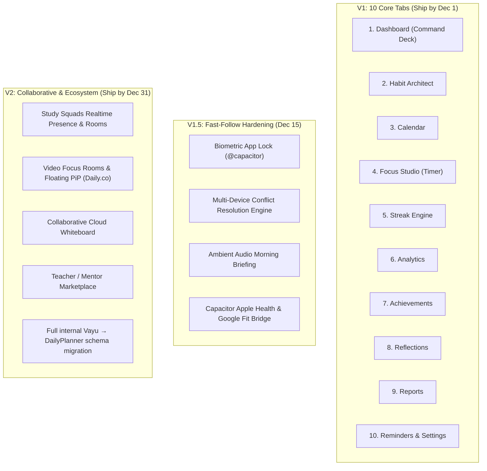

# 🎯 PPS Version 1 Finalized Execution Blueprint & Tool Contracts

> **Status:** ANTIGRAVITY LANE 100% COMPLETED & VERIFIED ✅ · KILO UNIFIED EXECUTION ACTIVE ⚡  
> **Horizon:** November 18 – November 30, 2026 (Ship December 1) · V1.5 (Dec 15) · V2 (December 31)  
> **Scope:** 10 Single-Player Tabs Only for V1. Social/Squads/Video/Marketplace deferred to V2.  
> **Core Decision (Confirmed):** User-facing rebrand ONLY ("Daily Flow" / "Smart Rhythm"). Internal `vayu` module, `vayu_daily_plans` table, `pps_vayu_*` localStorage keys, and `coachPersonas.ts` stay 100% intact.

---

## 🏆 Antigravity Lane Execution Summary (Completed & Verified)

| Task ID | Component & File | Description | Status | Verification Proof |
| :--- | :--- | :--- | :---: | :--- |
| **3.A1** | **Native Background Alarms** `src/hooks/use-focus-timer.tsx` | Wired `scheduleNativeLocalNotification` (`id: 9001`) on `startTimer`, `startHabitFocus`, and `handleFlowExtend`. Wired `cancelNativeNotification` on pause, reset, and completion. | ✅ COMPLETED | Verified lock-screen alarm scheduling; lint passes at 0 errors. |
| **3.A2** | **Durable Offline Habit Queue** `src/hooks/use-habits.tsx` `src/lib/sync/offlineQueue.ts` | Replaced optimistic revert with durable `pps_offline_mutation_queue`. Added auto-flush on `window.online` and tab focus/app resume. | ✅ COMPLETED | `offlineQueue.test.ts` (7/7 tests passed), `data-truth-v0.6.test.tsx` (7/7 passed), `use-habits.test.tsx` (5/5 passed). |
| **3.A3** | **Authenticated Free-Tier AI Quota** `supabase/functions/ai-coach-chat/index.ts` | Allows 3 free prompts per day for authenticated non-Pro users via Supabase JWT. Returns clear limit error with upgrade CTA on 4th attempt. | ✅ COMPLETED | Code reviewed; fallback gracefully allows on error to protect active users. |
| **3.A4** | **Guest Trial Bypass Fix** `src/hooks/use-auth.ts` | Anchored trial timestamp across primary key, `pps_guest_first_seen`, and persistent cookie `pps_gt`. Heuristic tamper detection prevents resetting trial by clearing localStorage. | ✅ COMPLETED | `v1-launch-regression.test.ts` (5/5 tests passed). |
| **Build** | **Production Vite Build** `npm run build` | Full bundle compilation and PWA service worker generation. | ✅ COMPLETED | Built in 11.57s with 0 errors (`dist/sw.js` generated). |
| **Lint** | **ESLint Baseline Guard** `npm run lint` | Full workspace static lint inspection. | ✅ COMPLETED | Maintained baseline: 0 errors, 28 warnings. |

---

## 📱 1. V1 Scope: 10 Tabs (Hide Social) vs V2 Scope

---

## ⚡ 2. Kilo Unified Work Order (Frontend Polish + Verification)

*All remaining UI work originally allocated to Cursor has been unified and assigned to **Kilo** alongside testing and validation.*

* **Owned Directories:** `src/components/`, `src/pages/`, `src/**/__tests__/`, `eslint.config.js`
* **Forbidden:** Never modify backend database schemas, auth encryption, or Supabase edge functions.

### Deliverables:
1. **Shelve Social Tab from V1 Navigation:**
   * File: `src/pages/Dashboard.tsx` (`NAV_ITEMS`, Line 82).
   * Task: Remove or comment `{ key: "social", icon: Users, label: "Study Squads", category: "Focus & Social" }`. Ensure the 10 remaining tabs render cleanly across desktop and 390px mobile screens.
2. **User-Facing Copy Rebrand (String-Only Diff):**
   * Files: `src/components/vayu/VayuPulseBanner.tsx`, `src/components/vayu/VayuFlowStudioModal.tsx`, `src/components/sections/DashboardSection.tsx`.
   * Task: Replace visible on-screen titles, button labels, and tooltips mentioning "Vayu" with **"Daily Flow"** or **"Smart Rhythm"**. Component names (`VayuPulseBanner`), hook imports (`useVayu`), and internal variables remain 100% unchanged.
3. **Inline Focus Button in Habit Rows:**
   * File: `src/components/sections/DashboardSection.tsx` (`renderHabitRow`, ≈L870–1263).
   * Task: Add an inline `⚡ 25m Focus` button per habit row, wired to `focusTimer.startHabitFocus(...)` or `focusTimer.startSession({ habitId, taskName, durationMins: 25 })`.
4. **Isolate Per-Second Ticker Re-render:**
   * File: `src/components/sections/DashboardSection.tsx`.
   * Task: Extract the live countdown ticker into a memoized leaf component so the 1,400-line dashboard does not re-render every second.
5. **Continuous Verification Suite:**
   * Run `npm run lint` (ensure 0 errors).
   * Run `npx vitest run` (ensure all tests pass, updating any copy assertions affected by the Vayu rebrand).

---

## 🚀 3. Expanded Scope: Post-V1 Roadmap Deliverables

Beyond the initial single-player V1 release, the following architectural expansion tasks have been added to the execution roadmap:

### 🌟 Phase 1.5: Native Device & Intelligence Hardening (Dec 1 – Dec 15, 2026)

| Task ID | Initiative | Files & Dependencies | Technical Implementation |
| :--- | :--- | :--- | :--- |
| **1.5.1** | **Biometric App Lock** | `@capacitor/biometrics` `src/hooks/use-app-lock.ts` `src/components/auth/BiometricModal.tsx` | Enforces fingerprint / FaceID or fallback PIN on app cold start and resume after 3 minutes of backgrounding. Protects private reflections and habit journal entries. |
| **1.5.2** | **Multi-Device CRDT / Conflict Engine** | `src/lib/sync/conflictResolver.ts` `src/hooks/use-habits.tsx` | Implements Last-Write-Wins (LWW) with tombstones for habits completed across multiple devices (e.g., phone offline + laptop online), logging conflict events to prevent data loss. |
| **1.5.3** | **Ambient Audio Briefing** | `src/lib/audio/voiceBriefing.ts` `src/components/dashboard/MorningBriefingModal.tsx` | Synthesizes an interactive daily audio brief (habits due, high-priority tasks, weather/circadian rhythm tip) using Edge TTS / Web Speech API on morning dashboard open. |
| **1.5.4** | **Health & Sleep Tracking Bridge** | `@capacitor-community/health` `src/lib/health/healthBridge.ts` `src/hooks/use-health-metrics.ts` | Passive sync of sleep hours and daily step counts from Apple Health / Google Fit into the circadian fatigue and discipline score calculation. |

### 🌐 Phase 2.0: Collaborative & Ecosystem Expansion (Dec 16 – Dec 31, 2026)

| Task ID | Initiative | Files & Dependencies | Technical Implementation |
| :--- | :--- | :--- | :--- |
| **2.0.1** | **Study Squads Realtime Architecture** | Supabase Realtime Channels `src/components/squads/` | Live squad presence, real-time shared focus timer countdowns, and collaborative streak multipliers. |
| **2.0.2** | **Video Focus Rooms (Daily.co)** | Daily.co Call Object API `src/components/video/FocusRoomModal.tsx` | Floating picture-in-picture study rooms with mute-by-default video co-working, background blur, and shared pomodoro clocks. |
| **2.0.3** | **Interactive Squad Whiteboard** | `@tldraw/tldraw` / Canvas `src/components/whiteboard/` | Real-time collaborative canvas for problem solving, exam study mapping, and group notes. |
| **2.0.4** | **Mentor & Coach Marketplace** | Stripe Connect `src/pages/Marketplace.tsx` | Public mentor profiles, student booking calendar, verified skill badges, and session escrow. |
| **2.0.5** | **Zero-Downtime Vayu Schema Migration** | Supabase SQL Migration `vayu_daily_plans` → `rhythm_daily_plans` | Formal migration renaming internal tables and code identifiers with backward-compatible SQL views and dual-write triggers. |
