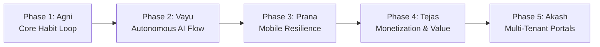

# 🗺️ PPS 6-Month Master Product Roadmap (Pancha Bhoota Architecture)

> **Document:** `docs/ROADMAP_6_MONTH.md`  
> **Project:** Personal Performance System (PPS)  
> **Horizon:** October 2026 – March 2027 (6 Months)  
> **Architects:** Jayadeep & Antigravity  
> **Guiding Principle:** Continuous, phased elevation rooted in the five fundamental elements (Pancha Bhoota). Zero speculative features; each phase must achieve 100% verified production readiness before transitioning to the next.

---

## 🏛️ The 5-Phase Architectural Lifecycle



---

### 🔥 Phase 1: Agni (Fire / The Forge) — Core Stabilization & Loop Integrity
- **Timeline:** Completed (August – September 2026)
- **Status:** 🟢 **FULLY VERIFIED & PRODUCTION-READY**
- **Core Focus:** Establishing an unbreakable foundation for habit formation, streak protection, and real-time social accountability.
- **Key Deliverables:**
  - **Habit Engine:** CRUD, categories, frequency filtering, check-offs with procedural Web Audio chords.
  - **Streak & XP Algorithm:** +10 XP per completion, level thresholds, hydration-gated celebration overlays to prevent false celebrations.
  - **Study Squads & Chat:** Unique 6-character alphanumeric invite codes, Postgres Realtime channel messaging, message pinning, and genuine Presence tracking.
  - **Automated Verification:** 24 unit & integration test suites established with 100% pass rate.

---

### 🌬️ Phase 2: Vayu (Air / Vital Breath) — Autonomous Real-Time Flow & AI Intake
- **Timeline:** October 2026 (Active Milestone)
- **Status:** 🟢 **COMPLETED & AUDITED**
- **Core Focus:** Eliminating mechanical button-clicking friction. Elevating PPS into an ambient, real-time operating system that plans, ingests natural inputs, and tracks completions automatically.
- **Key Deliverables:**
  - **Autonomous Day Planner (`vayuPlanner.ts`):** 45/15 dynamic rhythm builder that balances high-intensity focus sprints, mindful recharge breaks, and evening consolidation.
  - **Fluid Schedule Rebalancer:** Auto-shifts remaining time-blocks forward when unexpected delays occur, preventing schedule guilt.
  - **Focus Timer Auto-Completion Bus:** Custom event pipeline (`pps_focus_session_completed`) that marks active blocks complete and logs XP when Pomodoro timers expire.
  - **Natural Language Intake:** Audited to eliminate hardcoded regex. Connected to Phase 1 local classifier (`classifyIntent`), semantic token matching, and low-confidence Gemini edge function fallback.
  - **Security Fortification:** Strict DOMPurify sanitization running across all user text inputs before state mutations or Supabase cloud writes.

---

### ⚡ Phase 3: Prana (Life Energy / Vitality) — Mobile Resilience & Native Core
- **Timeline:** November – December 2026 (Months 2–3)
- **Status:** 🟡 **UPCOMING**
- **Core Focus:** Native mobile execution, background persistence, reliable native alarms, and rock-solid offline sync.
- **Milestone Goals:**
  - **Capacitor Mobile Deployment:**
    - Android APK & iOS bundle optimization using `@capacitor/android` and `@capacitor/core`.
    - Native status bar, safe area inset handling, and haptic feedback on habit check-offs.
  - **Native Background Alarms & Local Notifications:**
    - Transition web-only alarms to native device alarms using `@capacitor/local-notifications`.
    - Persistent sound and wake-lock capability so alarms fire even if the app process is suspended.
  - **Offline SQLite & Sync Engine:**
    - Migrate local storage queue to local SQLite database via Capacitor SQLite plugin.
    - True two-way conflict resolution with deterministic vector timestamps.
  - **Video Room Hardening:**
    - Provision managed Daily.co credentials or LiveKit instance to provide reliable TURN relay across firewalls and cellular networks.
    - Stress-test 2-device physical call connectivity.

---

### 💎 Phase 4: Tejas (Radiance / Value) — Monetization & Pro Marketplace
- **Timeline:** January 2027 (Month 4)
- **Status:** ⚪ **PLANNED**
- **Core Focus:** Sustainable monetization, live payment gateways, verified instructor class ticketing, and Pro AI features.
- **Milestone Goals:**
  - **Payment Gateway Integration:**
    - Live Stripe Billing integration for international subscriptions (Credit Card, Apple Pay, Google Pay).
    - Razorpay / UPI integration for domestic Indian users.
    - Supabase Edge Function webhook handlers for subscription lifecycle (`invoice.payment_succeeded`, `customer.subscription.deleted`).
  - **Pro Tier Feature Gating:**
    - Unmetered Gemini 2.0 Flash Pro AI coaching.
    - Advanced PDF report generation and custom analytics exports.
    - Unlimited Study Squads and cloud whiteboard exports.
  - **Live Class Marketplace:**
    - Teacher ticket booking with real-time seat decrementing and automated calendar invites.
    - Instructor revenue share payout ledger.

---

### 🌌 Phase 5: Akash (Ether / Omnipresence) — Multi-Tenant School & Enterprise Portals
- **Timeline:** February – March 2027 (Months 5–6)
- **Status:** ⚪ **PLANNED**
- **Core Focus:** Institutional adoption, multi-tenancy, academic curriculum integration, and mentor/teacher dashboards.
- **Milestone Goals:**
  - **Multi-Tenant Architecture:**
    - Organization and School accounts with tenant ID isolation via Postgres RLS (`auth.jwt() ->> 'org_id' = org_id`).
    - Role-Based Access Control (RBAC): SuperAdmin, Institution Admin, Teacher/Mentor, Student.
  - **Teacher / Mentor Management Console:**
    - Institutional syllabus ingestion: Batch import academic course curricula into structured semester study tracks.
    - Student cohort analytics: Identify at-risk students suffering from streak drop-off or low focus session counts.
    - Broadcast focus rooms: One-to-many lecture mode with hand-raising and breakout study rooms.

---

## ⏰ Daily 4-Hour Engineering Discipline (Learning & Building Split)

To ensure high-velocity execution while maintaining architectural mastery and zero technical debt, every working day is structured into an uncompromised 4-hour split:

```
┌──────────────────────────────────────┬──────────────────────────────────────┐
│       2 HOURS: DEEP LEARNING         │      2 HOURS: PRODUCTION BUILDING    │
│    (Architecture, Theory & R&D)      │     (Zero-Placeholder Execution)     │
└──────────────────────────────────────┴──────────────────────────────────────┘
```

### Block 1: Deep Learning & Architectural Exploration (2 Hours)
- **Focus Areas:**
  - **Core Systems & Performance:** Web Audio API digital signal processing, WebRTC ICE/STUN/TURN signaling, and memory management in long-running browser sessions.
  - **Security & Cryptography:** Zero-trust architecture, Row-Level Security optimization in PostgreSQL, XSS neutralization techniques, and OAuth token rotation.
  - **AI & NLP Engineering:** Prompt engineering for low-latency Edge Functions, vector embeddings for personal knowledge retrieval, and intent classification benchmarks.
  - **Mobile Native Architecture:** Capacitor bridge optimization, background execution limits in Android/iOS, and SQLite sync strategies.

### Block 2: Production Building & Hardening (2 Hours)
- **Execution Rules:**
  - **Zero Speculative Code:** Write code only against documented specifications in the Decision Log.
  - **Test-Driven Hardening:** Every new feature or engine change must be accompanied by comprehensive Vitest unit and integration test coverage.
  - **Zero Placeholder Commits:** No fake `setTimeout` loaders or mock buttons; if a feature is in progress, label it explicitly in code and UI as preview mode.
  - **Daily Git Verification:** Run full test suite (`npm test`) and production build (`npm run build`) before committing to `main`.
