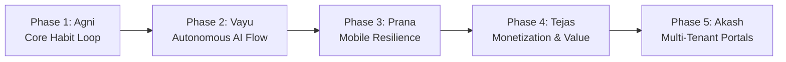

# 🗺️ PPS 6-Month Master Product Roadmap (Pancha Bhoota Architecture)

> **Document:** `docs/ROADMAP_6_MONTH.md`  
> **Project:** Personal Performance System (PPS)  
> **Horizon:** October 2026 – March 2027 (6 Months)  
> **Architects:** Jayadeep & Antigravity  
> **Last Updated:** November 2, 2026  
> **Guiding Principle:** Continuous, phased elevation rooted in the five fundamental elements (Pancha Bhoota). Zero speculative features; each phase must achieve 100% verified production readiness before transitioning to the next.

---

## 📋 PR Consolidation Log (All 16 PRs Reviewed & Resolved)

All 16 pull requests (PRs #1–#16) created by Jules have been reviewed, consolidated, and closed. Their findings are merged into this single roadmap document.

| PR # | Title | Status | Key Takeaway |
| :---: | :--- | :---: | :--- |
| **#1** | Audit dependencies, backend schemas, remove dead test code | CLOSED | Removed 7 unused npm dependencies. Created `docs/FEATURE_AUDIT.md`. Cleaned dead test files. |
| **#2** | Onboarding Wizard UI Scaffold & Route Guarding | MERGED ✅ | Delivered 4-screen Onboarding Wizard, `OnboardingGuard`, Track Presets, and Dashboard Architecture RFC. |
| **#3** | UX Flow Audit & Security Gap Analysis (V2) | MERGED ✅ | Delivered `docs/AUDIT_UX_AND_SECURITY_V2.md` — auth lifecycle, pricing consistency, competitor benchmarks. |
| **#4–#7** | Duplicate UX Audit attempts | CLOSED | Redundant re-runs of the same audit task. No new content beyond PR #3. |
| **#8** | UX Flow Audit & Security Gap Analysis V2 | MERGED ✅ | Minor iteration on the audit doc — same deliverable as #3. |
| **#9–#16** | 8 more duplicate UX Audit PRs | CLOSED | All closed on Nov 2, 2026. Zero unique content. Consolidated here. |

---

## 🔍 Consolidated Findings from All PRs & Audits

### A. Security & Auth Vulnerabilities (From Audit V2)

| # | Severity | Issue | File | Action Required |
| :---: | :---: | :--- | :--- | :--- |
| 1 | 🚨 **P0** | OAuth `#access_token` hash fragment collides with `HashRouter` — intermittent 404 on OAuth callback | `src/hooks/use-auth.ts` L298–311 | Parse `#access_token` before mounting `HashRouter` in `main.tsx` |
| 2 | 🔶 **P1** | Guest trial timestamp `pps_guest_created_at` can be deleted from localStorage to bypass 7-day trial | `src/hooks/use-auth.ts` L87–94 | Store guest creation timestamp server-side or in signed cookie |
| 3 | 🔵 **P2** | Expired guest can still access unguarded routes (`/marketplace`, `/classes`) | `src/routes/OnboardingGuard.tsx` L34–36 | Apply route protection consistently to all feature routes |
| 4 | ℹ️ **P3** | Storage purge `clearUserSessionStorage()` relies on key prefix matching — custom keys may survive logout | `src/hooks/use-auth.ts` L13–48 | Enforce `pps_` prefix naming convention for all localStorage keys |

### B. Pricing & Subscription Schema (From Audit V2)

| Finding | Status |
| :--- | :--- |
| Regional pricing (₹199/mo IN vs \$9.99/mo Global) is consistent across `plans.ts`, `Pricing.tsx`, `SettingsSection.tsx` | ✅ Verified |
| Stripe price IDs resolved from env vars (`VITE_STRIPE_PRO_MONTHLY_PRICE_ID`) | ✅ Verified |
| Savings badge "Save 44%" is consistent across all pages | ✅ Verified |
| Proposed `UNIFIED_REGIONAL_PRICING` typed schema for multi-region expansion | 🟡 Implement in Phase 4 |

### C. Competitor UX Friction Analysis (From Audit V2)

| Metric | Opal | Forest | Habitica | PPS (Current) | PPS (Target) |
| :--- | :--- | :--- | :--- | :--- | :--- |
| Time-to-Value | < 30s | < 45s | ~2 min | ~3.5 min | < 60s |
| First-Session Cognitive Load | Minimal | Minimal | Moderate | **High** | Low |
| Circadian Integration | Auto schedule | None | None | **Strong** | Best-in-class |
| Social/Peer Friction | Zero | Low | Moderate | Moderate | Low |

### D. ESLint & Code Quality Issues (From Oct 29 Debug Session)

| # | Severity | Issue | File | Status |
| :---: | :---: | :--- | :--- | :--- |
| 1 | ERROR | 6x `prefer-const` violations in 3D rotation math | `ThreePerformanceCanvas.tsx` L152–166 | ✅ Fixed |
| 2 | WARN | Missing `useEffect` deps (`joinRoom`, `leaveRoom`) | `FocusRoomStudio.tsx` L90–96 | 🟡 Pending |
| 3 | WARN | Missing `useEffect` dep (`updateState`) | `ScreenFinalReview.tsx` L45 | 🟡 Pending |
| 4 | WARN | Missing `useMemo` dep (`MONTHS`) | `AnalyticsSection.tsx` L997 | 🟡 Pending |
| 5 | WARN | Unnecessary dep `todayStr` in `useMemo` | `DashboardSection.tsx` L432 | 🟡 Pending |
| 6 | WARN | Missing `useEffect` dep (`habits`) | `DashboardSection.tsx` L615 | 🟡 Pending |
| 7 | WARN | Missing `useCallback` dep (`speak`) | `VoiceControlModal.tsx` L94 | 🟡 Pending |
| 8 | WARN | Missing `useCallback` dep (`addNotification`) | `use-notifications.tsx` L148 | 🟡 Pending |
| 9 | WARN | Unnecessary deps `getTodayStr` (3 hooks) | `use-habits.tsx` L718, L776, L802 | 🟡 Pending |
| 10 | WARN | Unnecessary deps `userId` (2 hooks) | `use-reminders.tsx` L257, L279 | 🟡 Pending |

### E. Feature Maturity Status (From Feature Audit)

| Feature | Production Ready | Partial/Mock | Action for Full Production |
| :--- | :---: | :---: | :--- |
| Habit Engine & Streaks | ✅ | | — |
| Vayu Autonomous Planner | ✅ | | — |
| Audio Synthesizer | ✅ | | — |
| Momentum Gauge & Analytics | ✅ | | — |
| Study Squads & Chat | ✅ | | — |
| AI Coach & Agent Tools | ✅ | | — |
| Reflections & Mood Vault | ✅ | | — |
| Reminders & Alarms | ✅ | | — |
| Security & Sanitization | ✅ | | — |
| Video Focus Rooms | | ⚠️ | Provision Daily.co API key or LiveKit TURN server |
| Collaborative Whiteboard | | ⚠️ | Stress-test 2-device remote sync; compress stroke payloads |
| Billing & Subscriptions | | ⚠️ | Connect live Stripe/Razorpay webhooks |
| Teacher/Mentor Classes | | ⚠️ | Build real booking checkout flow |

---

## 🏛️ The 5-Phase Architectural Lifecycle



---

### 🔥 Phase 1: Agni (Fire / The Forge) — Core Stabilization & Loop Integrity
- **Timeline:** Completed (August – September 2026)
- **Status:** 🟢 **FULLY VERIFIED & PRODUCTION-READY**
- **Core Focus:** Establishing an unbreakable foundation for habit formation, streak protection, and real-time social accountability.
- **Key Deliverables:**
  - **Habit Engine:** CRUD, categories, frequency filtering, check-offs with procedural Web Audio chords.
  - **Streak & XP Algorithm:** +10 XP per completion, level thresholds, hydration-gated celebration overlays to prevent false celebrations.
  - **Study Squads & Chat:** Unique 6-character alphanumeric invite codes, Postgres Realtime channel messaging, message pinning, and genuine Presence tracking.
  - **Automated Verification:** 24 unit & integration test suites established with 100% pass rate.

---

### 🌬️ Phase 2: Vayu (Air / Vital Breath) — Autonomous Real-Time Flow & AI Intake
- **Timeline:** October 2026 (Active Milestone)
- **Status:** 🟢 **COMPLETED & AUDITED**
- **Core Focus:** Eliminating mechanical button-clicking friction. Elevating PPS into an ambient, real-time operating system that plans, ingests natural inputs, and tracks completions automatically.
- **Key Deliverables:**
  - **Autonomous Day Planner (`vayuPlanner.ts`):** 45/15 dynamic rhythm builder that balances high-intensity focus sprints, mindful recharge breaks, and evening consolidation.
  - **Fluid Schedule Rebalancer:** Auto-shifts remaining time-blocks forward when unexpected delays occur, preventing schedule guilt.
  - **Focus Timer Auto-Completion Bus:** Custom event pipeline (`pps_focus_session_completed`) that marks active blocks complete and logs XP when Pomodoro timers expire.
  - **Natural Language Intake:** Audited to eliminate hardcoded regex. Connected to Phase 1 local classifier (`classifyIntent`), semantic token matching, and low-confidence Gemini edge function fallback.
  - **Security Fortification:** Strict DOMPurify sanitization running across all user text inputs before state mutations or Supabase cloud writes.

---

### 🔧 Phase 2.5: Hardening Sprint (NEW — November 2026)
- **Timeline:** November 1–15, 2026
- **Status:** 🟡 **IN PROGRESS**
- **Core Focus:** Fix all ESLint warnings, resolve hook dependency bugs, patch security vulnerabilities from the audit, and achieve 0 lint errors + 0 warnings across the entire codebase.
- **Milestone Goals:**
  - [ ] **P0 Security Fix:** Parse OAuth `#access_token` hash fragment before `HashRouter` mounts in `main.tsx`
  - [ ] **P1 Security Fix:** Server-side guest trial timestamp validation
  - [ ] **ESLint Zero-Warning Target:** Fix all 10 pending React hook dependency warnings (see Section D above)
  - [ ] **Route Protection:** Guard `/marketplace` and `/classes` routes for expired guest sessions
  - [ ] **Test Coverage Expansion:** Add tests for edge cases identified in the audit (guest trial bypass, OAuth hash collision, stale closure in FocusRoomStudio)
  - [ ] **Code Comprehension Drills:** Practice explaining each fixed module in 60-second interviewer pitches

---

### ⚡ Phase 3: Prana (Life Energy / Vitality) — Mobile Resilience & Native Core
- **Timeline:** November – December 2026 (Months 2–3)
- **Status:** 🟡 **UPCOMING**
- **Core Focus:** Native mobile execution, background persistence, reliable native alarms, and rock-solid offline sync.
- **Milestone Goals:**
  - **Capacitor Mobile Deployment:**
    - Android APK & iOS bundle optimization using `@capacitor/android` and `@capacitor/core`.
    - Native status bar, safe area inset handling, and haptic feedback on habit check-offs.
  - **Native Background Alarms & Local Notifications:**
    - Transition web-only alarms to native device alarms using `@capacitor/local-notifications`.
    - Persistent sound and wake-lock capability so alarms fire even if the app process is suspended.
  - **Offline SQLite & Sync Engine:**
    - Migrate local storage queue to local SQLite database via Capacitor SQLite plugin.
    - True two-way conflict resolution with deterministic vector timestamps.
  - **Video Room Hardening:**
    - Provision managed Daily.co credentials or LiveKit instance to provide reliable TURN relay across firewalls and cellular networks.
    - Stress-test 2-device physical call connectivity.
  - **UX Friction Reduction (From Competitor Analysis):**
    - 1-Tap "Quick Focus Session" floating action button for mobile.
    - Progressive 1-tap student role presets to reduce onboarding TTV from 3.5 min to < 60s.
    - 24-hour touch-friendly radial clock dial for habit scheduling.

---

### 💎 Phase 4: Tejas (Radiance / Value) — Monetization & Pro Marketplace
- **Timeline:** January 2027 (Month 4)
- **Status:** ⚪ **PLANNED**
- **Core Focus:** Sustainable monetization, live payment gateways, verified instructor class ticketing, and Pro AI features.
- **Milestone Goals:**
  - **Payment Gateway Integration:**
    - Live Stripe Billing integration for international subscriptions (Credit Card, Apple Pay, Google Pay).
    - Razorpay / UPI integration for domestic Indian users.
    - Supabase Edge Function webhook handlers for subscription lifecycle (`invoice.payment_succeeded`, `customer.subscription.deleted`).
  - **Unified Pricing Schema:**
    - Implement the `UNIFIED_REGIONAL_PRICING` TypeScript schema proposed in the Security Audit V2.
    - Single source of truth for all tier pricing, Stripe price IDs, and regional currency display.
  - **Pro Tier Feature Gating:**
    - Unmetered Gemini 2.0 Flash Pro AI coaching.
    - Advanced PDF report generation and custom analytics exports.
    - Unlimited Study Squads and cloud whiteboard exports.
  - **Live Class Marketplace:**
    - Teacher ticket booking with real-time seat decrementing and automated calendar invites.
    - Instructor revenue share payout ledger.

---

### 🌌 Phase 5: Akash (Ether / Omnipresence) — Multi-Tenant School & Enterprise Portals
- **Timeline:** February – March 2027 (Months 5–6)
- **Status:** ⚪ **PLANNED**
- **Core Focus:** Institutional adoption, multi-tenancy, academic curriculum integration, and mentor/teacher dashboards.
- **Milestone Goals:**
  - **Multi-Tenant Architecture:**
    - Organization and School accounts with tenant ID isolation via Postgres RLS (`auth.jwt() ->> 'org_id' = org_id`).
    - Role-Based Access Control (RBAC): SuperAdmin, Institution Admin, Teacher/Mentor, Student.
  - **Teacher / Mentor Management Console:**
    - Institutional syllabus ingestion: Batch import academic course curricula into structured semester study tracks.
    - Student cohort analytics: Identify at-risk students suffering from streak drop-off or low focus session counts.
    - Broadcast focus rooms: One-to-many lecture mode with hand-raising and breakout study rooms.

---

## 🎯 Interview Preparation: Code Comprehension Tracker

Every module we debug or build is tracked here as interview-ready material:

| Module | File | Lines | 60s Pitch Ready? | Socratic Q&A Done? |
| :--- | :--- | :---: | :---: | :---: |
| MomentumCommandDeck | `src/components/dashboard/v2/MomentumCommandDeck.tsx` | 806 | ✅ | ✅ |
| ThreePerformanceCanvas (3D rotation fix) | `src/components/dashboard/v2/ThreePerformanceCanvas.tsx` | 371 | ✅ | ✅ |
| FocusRoomStudio (hook deps) | `src/components/focus-rooms/FocusRoomStudio.tsx` | 490 | 🟡 Next | 🟡 Next |
| DashboardSection | `src/components/sections/DashboardSection.tsx` | ~1400 | ⚪ | ⚪ |
| SyllabusDecomposerModal | `src/components/syllabus/SyllabusDecomposerModal.tsx` | — | ⚪ | ⚪ |
| ParkinsonsLawInverterModal | `src/components/habits/ParkinsonsLawInverterModal.tsx` | — | ⚪ | ⚪ |
| useAuth (OAuth + Guest lifecycle) | `src/hooks/use-auth.ts` | ~550 | ⚪ | ⚪ |
| Vitality Engine | `src/lib/dashboard/vitality.ts` | — | ⚪ | ⚪ |
| Vayu Planner | `src/lib/vayu/vayuPlanner.ts` | — | ⚪ | ⚪ |
| AI Intent Classifier | `src/lib/ai/intentClassifier.ts` | — | ⚪ | ⚪ |

---

## ⏰ Daily 4-Hour Engineering Discipline (Learning & Building Split)

To ensure high-velocity execution while maintaining architectural mastery and zero technical debt, every working day is structured into an uncompromised 4-hour split:

```
┌──────────────────────────────────────┬──────────────────────────────────────┐
│       2 HOURS: DEEP LEARNING         │      2 HOURS: PRODUCTION BUILDING    │
│    (Architecture, Theory & R&D)      │     (Zero-Placeholder Execution)     │
└──────────────────────────────────────┴──────────────────────────────────────┘
```

### Block 1: Deep Learning & Architectural Exploration (2 Hours)
- **Focus Areas:**
  - **Core Systems & Performance:** Web Audio API digital signal processing, WebRTC ICE/STUN/TURN signaling, and memory management in long-running browser sessions.
  - **Security & Cryptography:** Zero-trust architecture, Row-Level Security optimization in PostgreSQL, XSS neutralization techniques, and OAuth token rotation.
  - **AI & NLP Engineering:** Prompt engineering for low-latency Edge Functions, vector embeddings for personal knowledge retrieval, and intent classification benchmarks.
  - **Mobile Native Architecture:** Capacitor bridge optimization, background execution limits in Android/iOS, and SQLite sync strategies.

### Block 2: Production Building & Hardening (2 Hours)
- **Execution Rules:**
  - **Zero Speculative Code:** Write code only against documented specifications in the Decision Log.
  - **Test-Driven Hardening:** Every new feature or engine change must be accompanied by comprehensive Vitest unit and integration test coverage.
  - **Zero Placeholder Commits:** No fake `setTimeout` loaders or mock buttons; if a feature is in progress, label it explicitly in code and UI as preview mode.
  - **Daily Git Verification:** Run full test suite (`npm test`) and production build (`npm run build`) before committing to `main`.

---

*This document represents the single source of truth for PPS product direction, consolidated from all 16 PRs, audit reports, and competitive intelligence analysis.*
